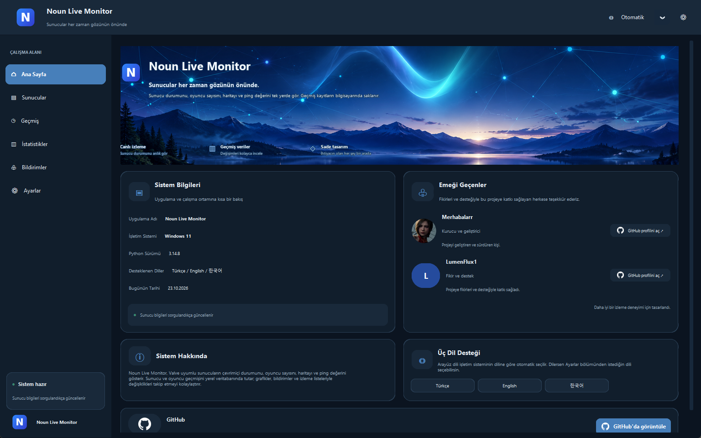
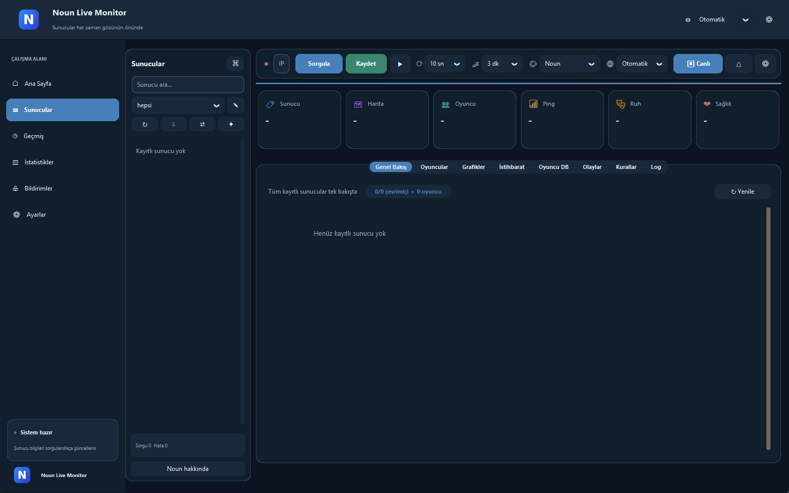
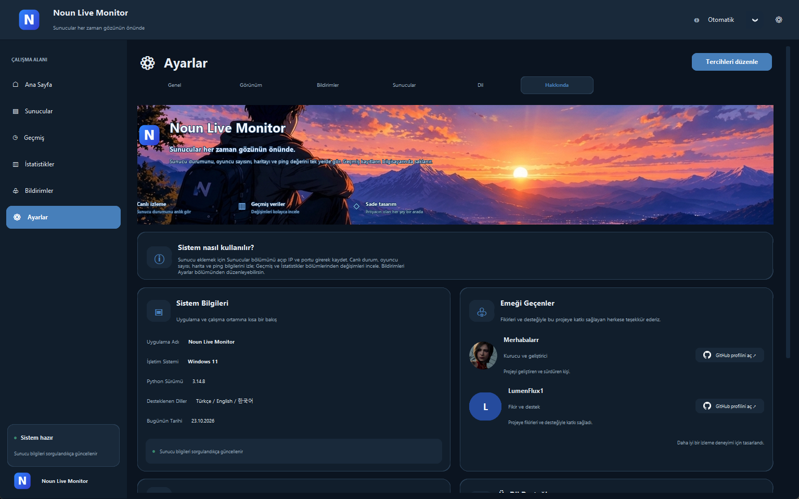
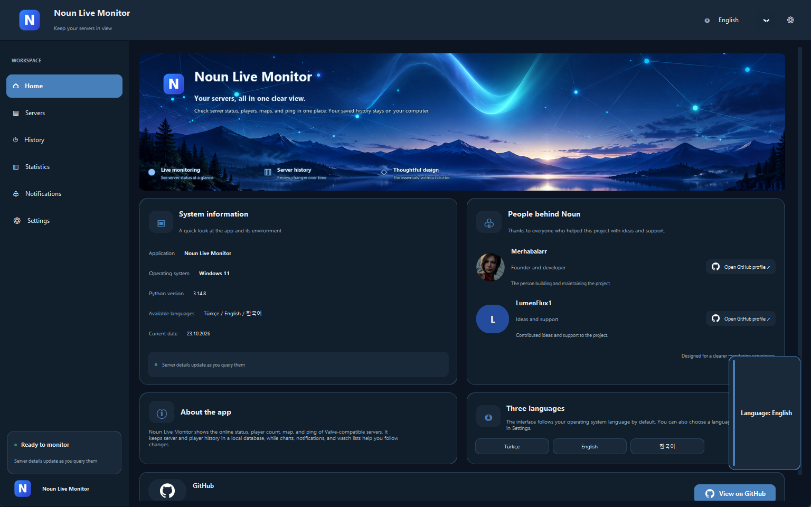
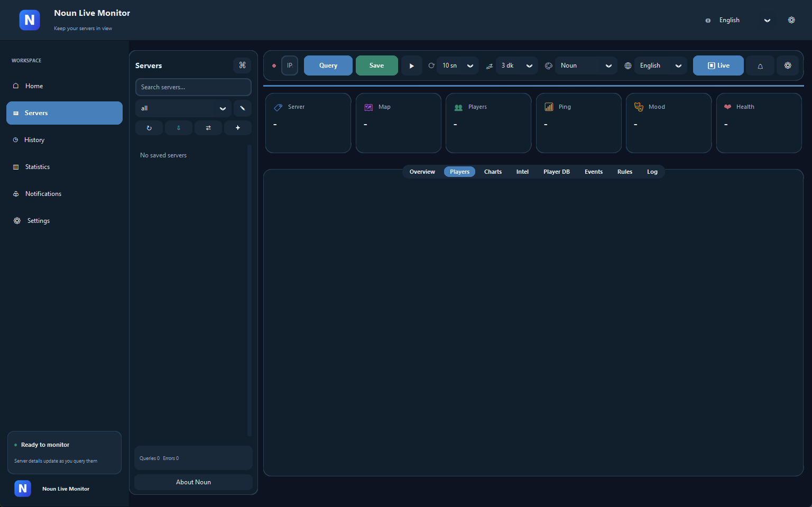
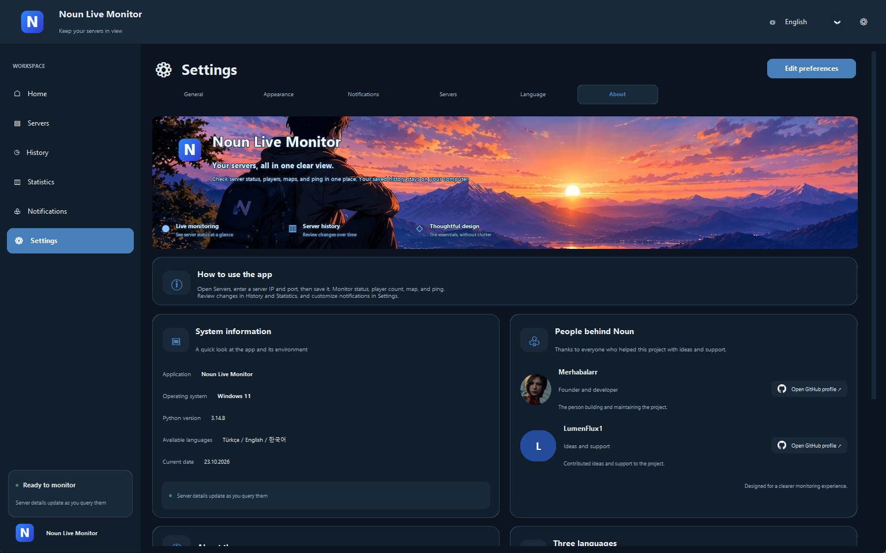
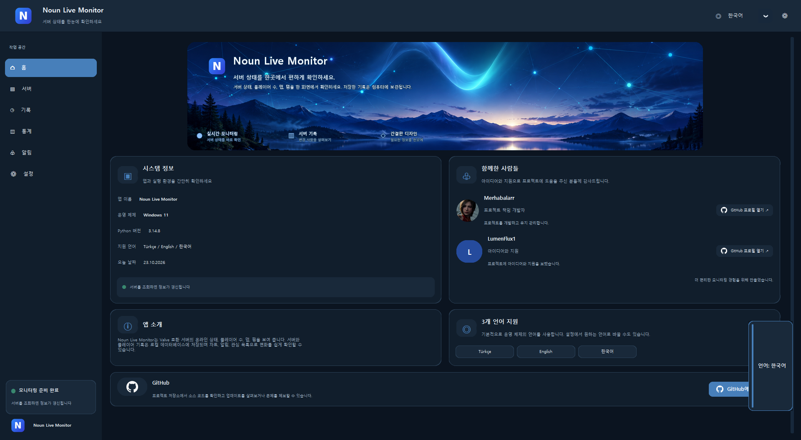
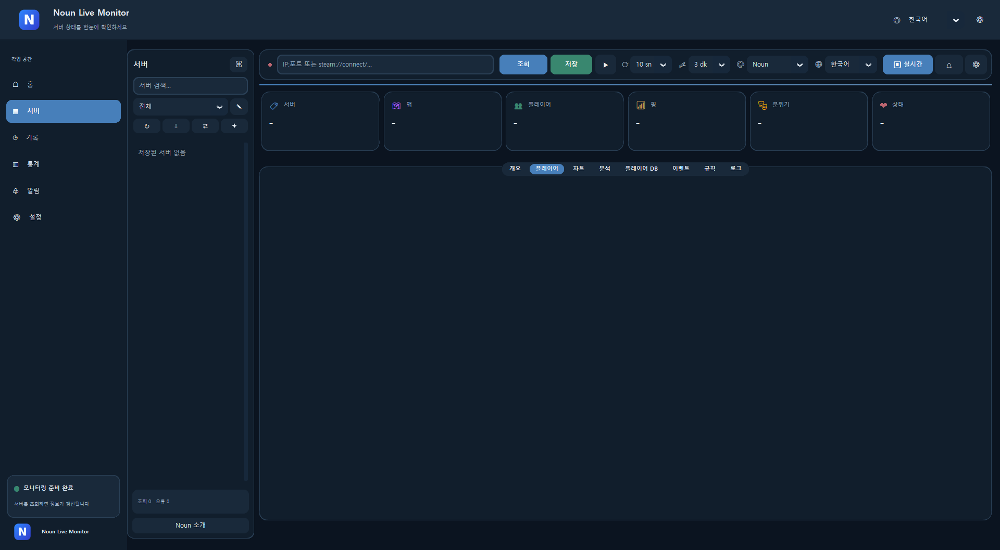
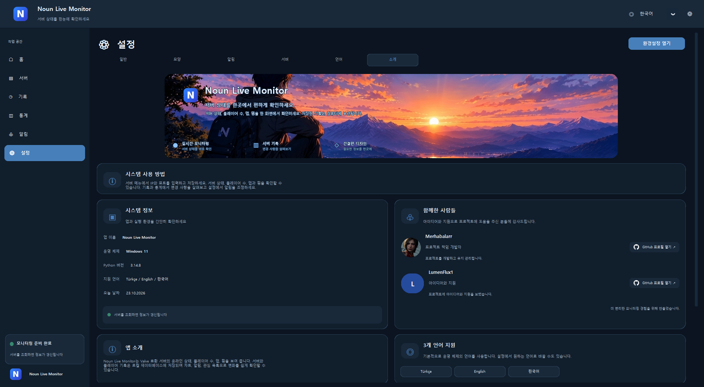

# Noun Live Monitor

**Oyun sunucularını canlı izle. Kim giriyor, kim çıkıyor, ping nasıl — hepsi tek ekranda.**

**Türkçe** · [English](#english) · [한국어](#한국어)

---

## Türkçe

Noun Live Monitor, Valve uyumlu (A2S) oyun sunucularını takip etmek için yazdığım bir Windows masaüstü uygulaması. Sunucunun IP:port bilgisini girmen yeterli; oyuncu sayısı, harita, ping ve oyuncu hareketleri canlı olarak akıyor. Geçmiş kayıtları bilgisayarında tutuluyor, internete bir şey yüklenmiyor.

### Ekran görüntüleri

  

  
  

### Neler yapabiliyor?

- **Canlı takip:** sunucu durumu, oyuncu sayısı, harita ve ping anlık güncellenir
- **Kayıtlı sunucular:** istediğin kadar sunucu ekle, arka planda izlensin
- **Oyuncu hareketleri:** giriş/çıkış, AFK takibi ve izleme listesi, bildirimlerle birlikte
- **Geçmiş ve grafikler:** sunucu kuralları, olaylar, grafikler ve geçmiş kayıtlar
- **Düzen araçları:** arama, etiket, favori, sunucu karşılaştırma
- **Dışa aktarma:** CSV çıktısı ve veritabanı yedeği
- **5 tema:** Noun, Slate, Ocean, Light ve renk körlüğü dostu Accessible
- **3 dil:** Türkçe, English, 한국어 (sistem diline göre otomatik seçilir, istersen elle değiştirirsin)

### Kurulum

Kurulum gerekmez, tek bir `.exe` dosyası yeter.

1. `Noun-Live-Monitor.exe` dosyasını bilgisayarınıza indirin.
2. İstediğin bir klasöre koy ve çift tıklayarak çalıştır. Python ya da başka bir şey kurman gerekmez.
3. Uygulamayı aç, **Sunucular** sayfasına git ve `IP:port` yazarak ilk sunucunu ekle.

Windows SmartScreen "Windows bilgisayarınızı korudu" uyarısı gösterirse **Ek bilgi → Yine de çalıştır** de. Uygulama imzalı olmadığı için bu uyarı normaldir.

Ayarların, sunucu listen ve geçmiş kayıtların `%APPDATA%\NounLiveMonitor` klasöründe durur. `.exe` dosyasını silmek bunları silmez; her şeyi kaldırmak istersen o klasörü de sil.

### Bot tespiti hakkında not

Standart A2S_PLAYER verisinde oyuncu başına bir "bot" bilgisi yoktur. Bu yüzden Noun, sadece isme, skora, boşta kalma süresine ya da aynı isme bakarak kimseye "bot" demez; bunlar yalnızca *inceleme sinyali* olarak gösterilir ve normal oyuncular da bu sinyalleri verebilir. Sunucunun bildirdiği bot sayısı varsa toplam olarak gösterilir, hangi oyuncunun bot olduğunu belirtmez.

### Uygulama açılmazsa

Hata olursa uygulama sessizce kapanmaz, bir uyarı penceresi gösterir. Sorun bildirirken `%APPDATA%\NounLiveMonitor\app.log` dosyasının son satırlarını paylaşırsan çok yardımcı olur.

### Emeği geçenler

- **Geliştirici:** [Merhabalarr](https://github.com/merhabalarrdev)
- **Fikir ve destek:** [LumenFlux1](https://github.com/LumenFlux1)

Proje Merhabalarr'a aittir ve onun tarafından geliştirilmektedir. Dağıtmadan önce depodaki lisans/kullanım koşullarına bakın. GitHub simgesiyle ilgili not için [THIRD_PARTY_NOTICES.md](THIRD_PARTY_NOTICES.md) dosyasına bakabilirsin.

---

<b>English</b>

 

Noun Live Monitor is a Windows desktop app I built for keeping an eye on Valve-compatible (A2S) game servers. Type in a server's IP:port and you get live player counts, map, ping, and player activity. History is stored on your own machine and nothing is uploaded anywhere.

### Screenshots

  

  
  

### What it does

- **Live monitoring:** server status, player count, map, and ping update in real time
- **Saved servers:** add as many as you like and they are watched in the background
- **Player activity:** joins/leaves, AFK tracking, and a watch list with notifications
- **History and charts:** server rules, events, charts, and past records
- **Organizing tools:** search, tags, favorites, server comparison
- **Export:** CSV export and database backup
- **5 themes:** Noun, Slate, Ocean, Light, and a color-vision-friendly Accessible theme
- **3 languages:** Türkçe, English, 한국어 (picked from your system language, changeable any time)

### Installation

No installer needed, just a single `.exe` file.

1. Download the `Noun-Live-Monitor.exe` file to your computer.
2. Put it in any folder and double-click to run. You don't need Python or anything else.
3. Open the app, go to **Servers**, and add your first server as `IP:port`.

If Windows SmartScreen shows a "Windows protected your PC" warning, click **More info → Run anyway**. The app isn't code-signed, so this warning is expected.

Settings, your server list, and history live in `%APPDATA%\NounLiveMonitor`. Deleting the `.exe` does not remove them; delete that folder too if you want to wipe everything.

### A note on bot detection

Standard A2S_PLAYER data has no per-player bot flag. Because of that, Noun never calls anyone a bot based only on a name, score, idle time, or duplicate name. Those are shown as *review signals* only, and normal players can trigger them too. If a server reports a bot count, it is shown as a server-wide total and doesn't say which player is a bot.

### If the app won't start

On a fatal error the app shows a message instead of closing silently. When reporting a problem, please include the last lines of `%APPDATA%\NounLiveMonitor\app.log`.

### Credits

- **Developer:** [Merhabalarr](https://github.com/merhabalarrdev)
- **Ideas and support:** [LumenFlux1](https://github.com/LumenFlux1)

The project is owned and developed by Merhabalarr. Please check the repository terms before redistributing. See [THIRD_PARTY_NOTICES.md](THIRD_PARTY_NOTICES.md) for the note on the GitHub mark.

---

<b>한국어</b>

 

> 🌸 **안녕하세요! 한국에 관심과 애정을 가지고 있는 개발자입니다. 제 프로젝트를 찾아주셔서 정말 감사합니다!**
>
> 저는 평소 한국의 문화와 언어에 관심이 많고, 한국에 대해 조금씩 알아가며 새로운 것들을 배우는 시간을 좋아합니다. 아직 배워 가는 과정에 있지만, 한국어도 꾸준히 공부하면서 조금씩 실력을 키워 나가고 있습니다.
>
> 이렇게 제가 직접 만든 프로젝트를 소개하고, 한국어로도 제 작업을 공유할 수 있다는 점이 저에게는 특별하고 뜻깊습니다. 언젠가는 한국어로 더 자연스럽게 소통하고, 한국의 개발자분들과도 서로의 프로젝트와 아이디어를 나눌 수 있으면 좋겠습니다.
>
> 부족한 부분도 있겠지만, 앞으로도 하나씩 배우고 발전하면서 더 좋은 프로젝트를 만들어 나가고 싶습니다. 방문해 주셔서 감사드리며, 편하게 둘러봐 주세요! 😊

Noun Live Monitor는 Valve 호환(A2S) 게임 서버를 쉽게 확인하려고 만든 Windows 데스크톱 프로그램입니다. 서버의 IP:port만 입력하면 접속 인원, 맵, 핑, 플레이어 활동을 실시간으로 볼 수 있습니다. 기록은 내 컴퓨터에만 저장되며 외부로 전송되지 않습니다.

### 스크린샷

  

  
  

### 주요 기능

- **실시간 모니터링:** 서버 상태, 접속 인원, 맵, 핑을 실시간으로 갱신
- **서버 저장:** 원하는 만큼 서버를 추가하면 백그라운드에서 계속 확인
- **플레이어 활동:** 입장/퇴장, AFK 확인, 알림이 있는 관찰 목록
- **기록과 그래프:** 서버 규칙, 이벤트, 그래프, 지난 기록
- **관리 도구:** 검색, 태그, 즐겨찾기, 서버 비교
- **내보내기:** CSV 내보내기 및 데이터베이스 백업
- **5가지 테마:** Noun, Slate, Ocean, Light, 그리고 색각 이상 사용자를 고려한 Accessible
- **3개 언어:** Türkçe, English, 한국어 (시스템 언어에 맞춰 자동 선택, 언제든 변경 가능)

### 설치 방법

별도의 설치 과정 없이 `.exe` 파일 하나로 실행됩니다.

1. `Noun-Live-Monitor.exe` 파일을 컴퓨터에 다운로드합니다.
2. 원하는 폴더에 두고 더블클릭해서 실행하세요. Python 등 다른 프로그램은 필요 없습니다.
3. 프로그램을 열고 **서버** 페이지에서 `IP:port`를 입력해 첫 서버를 추가하세요.

Windows SmartScreen에서 "Windows의 PC 보호" 경고가 나타나면 **추가 정보 → 실행**을 누르세요. 코드 서명이 되어 있지 않아 나타나는 정상적인 경고입니다.

설정, 서버 목록, 기록은 `%APPDATA%\NounLiveMonitor` 폴더에 저장됩니다. `.exe`를 삭제해도 이 폴더는 남으므로, 모두 지우려면 폴더도 삭제하세요.

### 봇 판별에 대한 안내

기본 A2S_PLAYER 데이터에는 플레이어별 봇 정보가 없습니다. 그래서 Noun은 이름, 점수, 대기 시간, 중복 이름만 보고 누군가를 봇이라고 단정하지 않으며, 이런 항목은 *확인이 필요한 신호*로만 표시됩니다. 일반 플레이어도 해당될 수 있습니다. 서버가 봇 수를 알려 주면 서버 전체 합계로만 표시되고, 어떤 플레이어가 봇인지는 알려 주지 않습니다.

### 프로그램이 실행되지 않을 때

치명적인 오류가 생기면 조용히 꺼지지 않고 안내 창이 표시됩니다. 문제를 알려 주실 때 `%APPDATA%\NounLiveMonitor\app.log` 파일의 마지막 부분을 함께 보내 주시면 큰 도움이 됩니다.

### 만든 사람

- **개발자:** [Merhabalarr](https://github.com/merhabalarrdev)
- **아이디어 및 지원:** [LumenFlux1](https://github.com/LumenFlux1)

프로젝트를 방문해 주셔서 감사합니다. 앞으로도 더 나은 프로그램을 만들기 위해 꾸준히 배우고 개선해 나가겠습니다!

